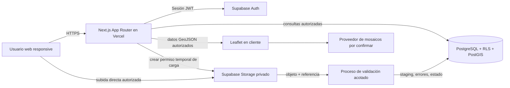
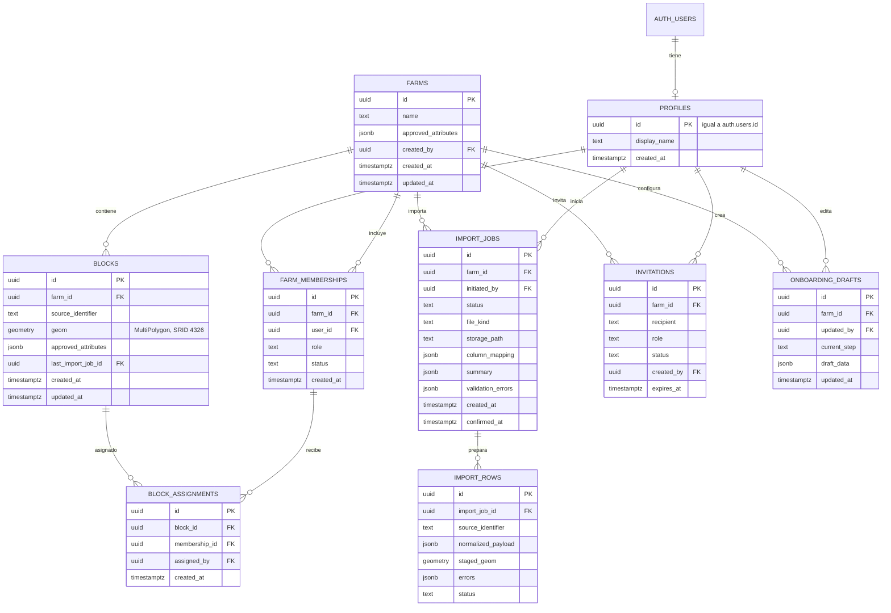

# CER Analytics — Especificación técnica de la primera versión

**Estado:** propuesta para iniciar desarrollo por etapas
**Versión:** 0.1
**Fecha:** 6 de noviembre de 2026
**Alcance:** especificación; no constituye una implementación

## 1. Propósito y límites

Esta especificación convierte las decisiones de alcance entregadas para CER Analytics V1 en requisitos, flujos, arquitectura, modelo de datos, permisos, estrategia de seguridad, plan de pruebas y hitos de trabajo. La V1 cubre onboarding web conectado, administración del fundo, importación de planillas y geometrías y asignación de muestreadores.

Quedan fuera de V1: operación offline, dibujo manual de polígonos, importación de Shapefile e historial avanzado de cosechas. Se conserva el prototipo HTML original como referencia visual; no forma parte del código de producción ni se reemplaza por esta especificación.

### Convenciones

- **Documentado/decidido:** está en los documentos de referencia o en las decisiones de alcance de este encargo.
- **Propuesta técnica:** decisión recomendada para hacer implementable la V1; debe validarse donde se marque como pendiente.
- No se consideran reglas de producción los valores, nombres o filas de ejemplo que vienen precargados en el prototipo HTML.

## 2. Requisitos funcionales

| ID | Requisito | Criterio de aceptación de V1 |
|---|---|---|
| RF-01 | Registro e inicio/cierre de sesión | Una persona puede crear una identidad, autenticarse, cerrar sesión y recuperar acceso según la configuración aprobada de Supabase Auth. |
| RF-02 | Perfil y pertenencia a fundos | La persona autenticada puede ver los fundos y el rol a los que tiene acceso; las consultas se aíslan por fundo. |
| RF-03 | Crear y configurar fundo | Un administrador autorizado puede crear un fundo y completar sus campos aprobados. El formulario no introduce catálogos o datos de CER no confirmados. |
| RF-04 | Guardar y recuperar onboarding | El avance y los datos en borrador persisten entre sesiones y se recuperan después de volver a iniciar sesión. El estado distingue borrador, revisión y completado. |
| RF-05 | Importar Excel/CSV | Una persona autorizada puede cargar `.xlsx` y `.csv`, inspeccionar columnas/filas y corregir errores de importación antes de confirmar. |
| RF-06 | Importar KML/GeoJSON | Una persona autorizada puede cargar `.kml`, `.geojson` o `.json` GeoJSON, revisar las geometrías detectadas y resolver errores antes de confirmar. |
| RF-07 | Validar y corregir | La interfaz informa errores por archivo, fila/campo o geometría de forma entendible. Se permite corregir los valores importables antes de confirmar. No se aplican umbrales agronómicos sin aprobación explícita. |
| RF-08 | Confirmar importación | Solo una importación sin errores bloqueantes puede confirmarse. La confirmación actualiza cuarteles y atributos en una transacción lógica y deja trazabilidad de la importación. |
| RF-09 | Visualizar cuarteles | El usuario autorizado puede ver las geometrías persistidas en Leaflet sobre un mapa base, seleccionar un cuartel y consultar los datos aprobados asociados. |
| RF-10 | Asignar muestreadores | El administrador puede invitar/asociar muestreadores y asignarlos a uno o más cuarteles. El muestreador solo accede a los cuarteles asignados según la política confirmada. |
| RF-11 | Gestionar usuarios y roles | El administrador puede consultar miembros y permisos, invitar miembros y administrar asignaciones permitidas. Los cambios de rol quedan registrados. |
| RF-12 | Estado y errores de importación | El usuario puede consultar el estado de cada importación: iniciada, cargada, validando, requiere corrección, lista para confirmar, confirmada o fallida. |

## 3. Requisitos no funcionales

| ID | Requisito | Enfoque / aceptación |
|---|---|---|
| RNF-01 Seguridad y aislamiento | Supabase Auth, RLS en tablas expuestas y políticas de Storage limitan datos por membresía y rol. La autorización se aplica en servidor/base, no solo en la UI. |
| RNF-02 Protección de archivos | Archivos privados, validación de formato/contenido, límites configurables y acceso temporal autorizado. Ningún archivo predial se sirve desde un bucket público. |
| RNF-03 Integridad | Las importaciones pasan por staging y validación antes de modificar los datos vigentes. Las escrituras finales son atómicas o reintentables sin duplicar resultados. |
| RNF-04 Responsive y usabilidad | Flujos utilizables en móvil, tablet y escritorio; errores asociados al campo/fila y navegación por teclado para controles esenciales. |
| RNF-05 Vercel | La aplicación se despliega como Next.js App Router en Vercel. No depende de disco local persistente ni enruta archivos grandes por el cuerpo de una Function. |
| RNF-06 Observabilidad | Se conserva estado, actor, fechas y resultado de importaciones; los registros no contienen archivos, tokens ni secretos. |
| RNF-07 Mantenibilidad | Código TypeScript por dominios, validación compartida de contratos y migraciones SQL versionadas. Evitar servicios y dependencias que no resuelvan una necesidad de V1. |
| RNF-08 Recuperación | Si falla una carga o validación, el borrador puede retomarse o descartarse de acuerdo con la política de retención por confirmar; no se confirma una carga parcial silenciosamente. |

La meta de onboarding inferior a diez minutos es una hipótesis de producto documentada, no un SLA técnico de esta especificación. Deberá medirse en piloto. Los documentos también discrepan entre una reducción de 80 % y 85 % en costos/tiempos de habilitación; ninguna cifra se usa como criterio de aceptación de V1 hasta que CER la resuelva.

## 4. Casos de uso principales

| Caso | Actor principal | Flujo resumido | Resultado |
|---|---|---|---|
| UC-01 Crear cuenta e ingresar | Usuario | Registra cuenta o acepta invitación, confirma identidad según configuración, inicia sesión. | Sesión asociada a un perfil. |
| UC-02 Crear/configurar fundo | Administrador | Crea fundo, completa campos confirmados y guarda borrador. | Fundo creado y onboarding recuperable. |
| UC-03 Importar planilla | Administrador/Agrónomo | Selecciona archivo, carga a Storage, revisa detección de columnas, corrige errores y pasa a confirmación. | Filas staging validadas y lista de cambios. |
| UC-04 Importar geometrías | Administrador/Agrónomo | Carga KML/GeoJSON, revisa detección/normalización de geometrías y vinculación con los datos tabulares. | Geometrías staging listas o errores accionables. |
| UC-05 Revisar y confirmar | Administrador/Agrónomo autorizado | Revisa errores y resumen; confirma explícitamente. | Cuarteles actualizados y trabajo de importación auditado. |
| UC-06 Visualizar cuarteles | Miembro autorizado | Abre mapa, filtra/selecciona cuartel y revisa sus datos permitidos. | Mapa y ficha con geometría real. |
| UC-07 Invitar y asignar muestreador | Administrador | Invita/selecciona miembro y asigna cuarteles. | Membresía/asignación visible con el permiso correcto. |
| UC-08 Continuar onboarding | Miembro con permiso | Retoma el último paso persistido, revisa estado y continúa. | Progreso recuperado sin duplicar cambios. |

### Flujo principal del onboarding

1. Autenticación y selección/creación de fundo.
2. Datos básicos del fundo guardados como borrador.
3. Carga y revisión de tabla y geometrías; el orden entre ambas cargas puede ser configurable, pero la importación final necesita una clave de relación confirmada.
4. Corrección de errores bloqueantes y revisión de advertencias.
5. Confirmación explícita de la importación.
6. Vista cartográfica de los cuarteles persistidos.
7. Invitación/asignación del equipo y finalización.

## 5. Arquitectura propuesta

Next.js sirve la aplicación y las rutas de servidor ligeras en Vercel. Supabase gestiona identidad, PostgreSQL/PostGIS, archivos privados y permisos de Storage. La carga del archivo viaja desde el cliente a Supabase Storage mediante una autorización de carga de corta duración; la Function de Vercel recibe metadatos/estado y no actúa como proxy del binario. La validación está acotada por límites aprobados y se registra como trabajo reanudable.



**Límite operativo:** Vercel documenta actualmente un máximo de 4,5 MB para el cuerpo de solicitud/respuesta de una Function; también hay límites de duración, memoria y tamaño de bundle. La subida directa a Storage evita ese límite del cuerpo HTTP de la Function, pero no elimina los límites de CPU/memoria/tiempo al analizar archivos. V1 debe fijar tamaño y complejidad máximos después de una prueba con archivos representativos. Si se exceden, separar el análisis en procesamiento asíncrono es una evolución, no una dependencia inicial. [Vercel Functions: límites](https://vercel.com/docs/functions/limitations)

Los buckets privados de Supabase controlan acceso mediante políticas y permiten URL firmadas temporales; las tablas expuestas deben protegerse con RLS y privilegios mínimos. [Supabase Storage: buckets](https://supabase.com/docs/guides/storage/buckets/fundamentals) · [Supabase: Row Level Security](https://supabase.com/docs/guides/database/postgres/row-level-security)

## 6. Modelo de datos inicial

El diagrama define entidades técnicas mínimas. Los atributos de dominio agronómico y sus reglas quedan sujetos a confirmación. PostGIS es apropiado porque el producto debe guardar y visualizar geometrías reales; se recomienda almacenar geometrías normalizadas a SRID 4326 y devolver GeoJSON al mapa. No se asume que 4326 sea el CRS de entrada: el importador debe detectar/interpretar CRS conforme a reglas aprobadas o solicitar corrección.



### Reglas estructurales del modelo

- Claves primarias UUID; claves foráneas para relaciones y `created_at`/`updated_at` donde corresponda.
- Índices por `farm_id`, relaciones de membresía/asignación y geometría según consultas de mapa.
- Restricción única recomendada para `(farm_id, user_id)` en membresías activas y para identificador de cuartel por fundo **solo si CER confirma que dicho identificador es obligatorio y único**.
- Los registros de importación y borradores separan los datos aún no confirmados de los datos vigentes.
- `approved_attributes` es una zona transitoria flexible para atributos todavía no acordados; antes de estabilizar el modelo debe reemplazarse o acotarse a columnas/tablas tipadas confirmadas. No implica que cualquier dato arbitrario se considere válido.
- El historial avanzado de cosechas queda fuera de V1. No se diseña una tabla de cosechas sin el diccionario de datos del dominio.
- La eliminación de usuario/fundo y la política de retención de archivos requieren definición de negocio antes de fijar cascadas destructivas.

## 7. Roles y permisos

Autorización contextual por fundo: una identidad puede pertenecer a varios fundos y tener un rol en cada uno. La UI oculta acciones no permitidas, pero cada operación debe volver a verificar permiso en servidor y RLS.

| Acción | Administrador del fundo | Agrónomo | Muestreador | Soporte CER |
|---|---:|---:|---:|---:|
| Ver configuración y cuarteles del fundo | Sí | Sí | Solo cuarteles asignados (propuesta) | Solo acceso explícito y auditado (propuesta) |
| Crear/editar configuración del fundo | Sí | Sí, propuesta coherente con el onboarding | No | No por defecto |
| Cargar/importar/confirmar datos | Sí | Sí, propuesta | No | No por defecto |
| Gestionar miembros e invitaciones | Sí | No por defecto | No | No por defecto |
| Asignar muestreadores a cuarteles | Sí | No por defecto | No | No por defecto |
| Ver/editar asignaciones propias | Sí | Ver todas | Ver las propias | Solo si se autoriza temporalmente |
| Cambiar rol de administrador | Sí, sujeto a regla de transferencia por confirmar | No | No | No por defecto |

**Pendiente de aprobación:** la taxonomía de documentos menciona Administrador, Muestreador y Soporte CER; la propuesta de onboarding también habla de Administrador/Agrónomo. Confirmar si Administrador y Agrónomo son roles distintos; quién puede invitar; qué puede editar el muestreador; si soporte puede tener acceso a datos de clientes, cómo se autoriza y cuánto dura; y si un fundo admite más de un administrador. Hasta confirmarlo, aplicar mínimo privilegio y no habilitar acceso de soporte a datos productivos.

## 8. Flujo de carga, validación y confirmación

### 8.1 Secuencia común

1. Verificar sesión, membresía, rol y fundo objetivo.
2. Crear `import_job` en estado `initiated`, con identificador opaco y límites del tipo de archivo.
3. Emitir permiso de carga limitado a un objeto y ruta únicos del bucket privado.
4. El navegador sube el archivo directamente a Supabase Storage; el backend nunca confía en nombre, extensión o MIME informados por el navegador.
5. Marcar carga completa y validar tamaño, firma/formato, integridad y lectura segura.
6. Parsear a staging; registrar advertencias y errores con ubicación precisa.
7. Mostrar vista previa editable. Mantener intactos los datos vigentes.
8. Tras corregir errores bloqueantes, mostrar resumen de altas/cambios y pedir confirmación explícita.
9. Revalidar permiso y versión del trabajo; aplicar en transacción lógica idempotente, actualizar estado a `confirmed` y registrar actor/fecha.
10. Mostrar el resultado en mapa y permitir retomar el onboarding.

Estados propuestos: `initiated`, `uploaded`, `validating`, `needs_correction`, `ready_to_confirm`, `confirmed`, `failed`, `discarded`.

### 8.2 Excel y CSV

- Detectar hoja/encabezados y permitir mapeo explícito de columnas a campos aprobados.
- Validar estructura, codificación, celdas, tipos de datos esperados y campos obligatorios solo después de confirmar el diccionario de datos.
- No ejecutar macros, fórmulas ni contenido activo; tratar texto importado como datos y escapar al mostrarlo.
- Para CSV, definir codificación y separador aceptados; admitir detección con confirmación cuando exista ambigüedad.
- Mostrar errores por fila/columna y permitir editar los datos staging sin volver a cargar el archivo.
- Resolver duplicados/actualizaciones usando identificador y política de upsert que CER confirme; no asumir que el orden de filas representa identidad.

### 8.3 KML y GeoJSON

- Aceptar solo KML y GeoJSON/JSON autorizados; límite de tamaño y complejidad configurable.
- Rechazar XML con DTD/entidades externas y desactivar acceso de red durante parsing.
- Aceptar únicamente tipos geométricos acordados (propuesta inicial: Polygon/MultiPolygon); rechazar o reportar puntos, líneas, geometrías vacías o tipos mixtos hasta decisión.
- Comprobar estructura, coordenadas finitas, anillos cerrados, geometría no vacía y transformabilidad de CRS con una librería/proceso seguro.
- Normalizar para almacenamiento PostGIS en SRID acordado y serializar a GeoJSON para Leaflet.
- Detectar propiedades candidatas a identificador para vincular geometrías con filas tabulares; exigir confirmación o mapeo cuando no haya correspondencia inequívoca.
- Informar auto-intersecciones, solapes y geometrías duplicadas como validaciones por definir. No bloquear por un umbral espacial inventado.

### 8.4 Vinculación, actualización y errores

La importación Excel/CSV y la geográfica pueden llegar por separado; la clave de enlace debe ser estable. La confirmación conjunta requiere que CER defina identificador del cuartel, cardinalidad y qué pasa cuando un archivo omite cuarteles existentes. Error técnico del parser debe dejar el trabajo en `failed` y preservar el original conforme a retención aprobada; error corregible debe dejar el trabajo en `needs_correction`.

### 8.5 Límites y Vercel

Los límites de bytes, filas, vértices, número de geometrías y tiempo de retención son configuraciones pendientes, no reglas agronómicas. Deben definirse antes del piloto a partir de archivos reales anonimizados y pruebas de memoria/latencia. La arquitectura V1 procesa trabajos solo dentro de límites medidos de Vercel; si no es fiable hacerlo en una Function, se añade una cola/procesador asíncrono en un hito posterior antes de ampliar esos límites.

## 9. Estructura definitiva propuesta

```text
src/
  app/
    (auth)/
      login/
      register/
      reset-password/
    onboarding/
      [farmId]/
    farms/
      [farmId]/
        blocks/
        team/
        imports/
    api/
      imports/
      invitations/
  components/
    ui/
    layout/
    forms/
    map/
    import-review/
  features/
    auth/
    farms/
    memberships/
    blocks/
    imports/
    onboarding/
  lib/
    supabase/
      browser.ts
      server.ts
      middleware.ts
    authorization/
    validation/
    geo/
    spreadsheet/
  types/
supabase/
  migrations/
  seed.sql
  tests/
  config.toml
```

Componentes Leaflet deben cargarse solo en cliente. Los módulos `geo` y `spreadsheet` exponen contratos y reglas de parsing, pero no importan bibliotecas antes de fijar formatos, límites y evaluación de seguridad. Variables públicas y secretos de servidor se separan; `service_role` nunca se entrega al navegador.

## 10. Estrategia de seguridad

1. **Identidad:** Supabase Auth; proteger rutas y mutaciones del servidor. Definir política de registro abierto versus invitación antes de producción.
2. **Autorización:** RLS en cada tabla expuesta; membresía activa por fundo como condición base; permisos específicos por acción. Probar grants y políticas conjuntamente.
3. **Storage:** buckets privados; nombre/ruta generado por servidor bajo prefijo de fundo y trabajo; políticas que verifiquen membresía; URLs firmadas cortas y de un solo objeto cuando aplique; nunca acceso público a originales.
4. **Secretos:** clave `service_role`, secretos de invitaciones y credenciales solo en variables server-side de Vercel; rotación y separación por entorno.
5. **Archivos hostiles:** allowlist de extensiones/formatos, validación de firma y parser, límites contra archivos comprimidos o expansiones abusivas, timeout/memoria, no evaluar fórmulas/macros, escape de salida, no seguir enlaces externos. KML es XML: deshabilitar entidades externas/XXE.
6. **Transporte y datos:** TLS; cifrado de proveedor en reposo más control de acceso; no registrar contenido confidencial. Definir retención, eliminación y procedimiento de solicitudes de eliminación.
7. **Auditoría:** registrar actor, fundo, importación, acción, hora y resultado en cambios sensibles; nunca guardar tokens o URLs firmadas en logs.
8. **Abuso:** límites de intentos, tamaño y tasa para autenticación/cargas; protección CSRF/origin según flujo de sesión; mensajes de error sin detalles internos.
9. **Dependencias:** mantener conjunto mínimo, revisar vulnerabilidades y licencias; evaluar librerías geoespaciales/spreadsheets antes de incorporarlas.
10. **Entornos:** proyectos Supabase y Vercel separados para desarrollo, staging y producción; datos de demostración separados de datos de clientes.

## 11. Plan de pruebas

Este plan define lo que se ejecutará durante implementación; todavía no se ejecutaron pruebas.

| Nivel | Pruebas previstas | Criterio de salida |
|---|---|---|
| Unitarias | Validadores de campos confirmados, normalización CRS, estados de importación, mapeo de columnas, autorización por rol. | Casos válidos, inválidos y límites cubiertos; ninguna regla de demo convertida en regla de negocio sin aprobación. |
| Integración | RLS/grants, Storage privado, creación y recuperación de import jobs, staging, reintento e idempotencia de confirmación. | Usuario de otro fundo no puede leer ni alterar filas/archivos; confirmar dos veces no duplica datos. |
| Archivos | XLSX/CSV de ejemplo reales anonimizados; encabezados desconocidos, vacíos, duplicados, codificaciones, archivos corruptos, KML/GeoJSON malformados, geometrías vacías y CRS faltante. | Error localizado, sin afectar datos productivos; formato aceptado produce preview reproducible. |
| Seguridad | Acceso cruzado de fundos, escalada de rol, URL expirada, carga de MIME falsificado, XML XXE, XSS en celdas/nombres, ZIP bomb cuando aplique. | Rechazo seguro; sin exposición de archivo/datos ni ejecución de contenido. |
| E2E | Registro/login, crear fundo, pausar/retomar, importar tabla y geometría, corregir, confirmar, visualizar mapa, invitar/asignar miembro. | Flujo completo comprobado con roles distintos y errores visibles. |
| Responsive/accesibilidad | Anchuras móvil/tablet/escritorio, teclado, foco, etiquetas, contraste, mensajes para lectores de pantalla. | Tareas principales realizables sin interacción exclusiva con ratón; sin bloqueo visual en pantallas estrechas. |
| Rendimiento/capacidad | Tamaños/filas/vértices crecientes, concurrencia moderada y límites de Functions/Storage/DB. | Topes documentados y dentro de presupuesto de latencia/memoria acordado antes del piloto. |
| Despliegue | Preview y producción en Vercel, variables, migraciones, URLs Auth, CORS/orígenes, mapas y políticas Storage. | Despliegue repetible; secretos ausentes del bundle cliente; smoke test exitoso. |

No se deben fabricar datos de clientes para pruebas. Usar fixtures sintéticos claramente identificados o archivos anonimizados con autorización.

## 12. Plan de implementación por hitos

### Hito 0 — Cierre de decisiones de dominio

Confirmar campos del fundo/cuártel, roles, identificador de cuartel, relación planilla-geometría, CRS/formas geométricas, política de registro/invitación, límites de carga, retención y proveedor de mosaicos. **Salida:** diccionario de datos y reglas estructurales aprobados.

### Hito 1 — Base del proyecto y acceso

Preparar Next.js App Router, TypeScript, Tailwind, Vercel por entornos, clientes Supabase, Auth, perfiles, migraciones, membresías, primeras políticas RLS y rutas protegidas. **Salida:** usuario puede ingresar y ver solo sus fundos autorizados.

### Hito 2 — Fundos y onboarding persistente

Implementar creación/configuración, formularios responsive y borradores recuperables. **Salida:** flujo sin importaciones recupera su paso y datos después de cerrar sesión.

### Hito 3 — Importación tabular

Agregar Storage privado, import jobs, parser XLSX/CSV, mapeo y corrección de staging. **Salida:** vista previa y confirmación idempotente bajo límites de Vercel acordados.

### Hito 4 — Importación geográfica y mapa

Agregar KML/GeoJSON, comprobaciones geométricas estructurales, asociación con cuarteles y mapa Leaflet. **Salida:** geometría confirmada visible en mapa, sin reglas agronómicas no aprobadas.

### Hito 5 — Equipo y asignaciones

Invitaciones, gestión de membresía/rol y asignación a cuarteles, con permisos validados por servidor/RLS. **Salida:** muestreador con alcance limitado y verificable.

### Hito 6 — Endurecimiento y piloto

Completar pruebas, telemetría segura, pruebas de capacidad, despliegue y revisión con usuarios. Validar la meta de tiempo en piloto y ajustar límites/flujo según evidencia.

Cada hito debe cerrar con criterios de aceptación, migraciones aplicables, revisión de permisos y evidencia de pruebas antes de iniciar el siguiente.

## 13. Campos y reglas que requieren confirmación expresa

### Datos de negocio

- Campos obligatorios del fundo: nombre, región, comuna u otros; el prototipo y los informes no forman un diccionario definitivo.
- Campos obligatorios del cuartel y atributos agronómicos de V1: especie, variedad, año de plantación y densidad aparecen en el prototipo; no se asumirá que sean todos los campos ni que sus nombres sean oficiales.
- Si un cuartel contiene una sola combinación de especie/variedad o varias.
- Identificador estable del cuartel, unicidad y correspondencia entre datos y geometrías.
- Si V1 incluye datos de cosecha simples, o los excluye totalmente junto con el historial avanzado.

### Reglas de validación

- Rangos válidos de densidad/años/otros parámetros (no usar los valores incrustados en la demo).
- CRS permitidos, política ante ausencia/ambigüedad de CRS, transformación autorizada y geometrías aceptadas.
- Tratamiento de solapes, huecos, geometrías inválidas, duplicados y cuarteles omitidos en una actualización.
- Obligatorios, nulos, separadores/encoding de CSV, hojas de Excel admisibles, redondeo y formato decimal/fecha.
- Qué errores bloquean y qué advertencias pueden confirmarse.

### Operación y gobierno

- Administrador versus agrónomo; permisos de soporte CER; número de administradores; transferencia y revocación de propiedad.
- Método de invitación, expiración, reenvío y revocación; alcance de asignaciones del muestreador.
- Tamaño máximo, número de filas/geometrías/vértices, duración del procesamiento, cuotas y retención/borrado de archivos.
- Proveedor de tiles/mapa, atribución y condiciones de uso; expectativas de mapa en conectividad lenta.
- Métrica de éxito del onboarding y resolución de la discrepancia 80 %/85 %.

## 14. Riesgos técnicos y mitigaciones

| Riesgo | Mitigación propuesta |
|---|---|
| Archivos más grandes o complejos de lo que procesan las Functions | Carga directa a Storage, límites explícitos medidos, streaming/parseo controlado cuando la librería lo soporte; servicio asíncrono si la evidencia lo exige. |
| CRS incorrecto genera mapa desplazado | Detectar/mostrar CRS, no adivinar silenciosamente, pedir confirmación o rechazar según política aprobada; normalizar antes de guardar. |
| No hay clave entre Excel y geometrías | Bloquear confirmación conjunta hasta que se defina identificador/mapeo inequívoco. |
| Interpretar datos de demo como reglas reales | Mantener fixtures fuera del validador productivo y exigir aprobación del diccionario y reglas. |
| Acceso entre fundos por una política incompleta | RLS por membresía en todas las entidades y objetos; tests adversariales con usuarios de fundos distintos. |
| Storage conserva datos más tiempo del necesario | Definir ciclo de vida, borrado y acceso temporal antes de producción. |
| Map tiles dependen de proveedor/red/licencia | Seleccionar proveedor, atribución y comportamiento con mala conectividad antes del piloto. |
| Parser pesado aumenta costos/latencia | Medir con archivos representativos; fijar límites y mover procesamiento fuera de la request si la prueba no cumple. |

## 15. Referencias de partida

- Informe de diagnóstico de CER Analytics y selección de propuesta: `Informe innovación 3-1.pdf`.
- Informe de ideación, requerimientos y propuesta de valor: `EV2 INNO 3.pdf`.
- Prototipo de onboarding asistido (solo referencia visual): `CER Analytics · Onboarding asistido (prototipo).html`.
- [Límites vigentes de Vercel Functions](https://vercel.com/docs/functions/limitations).
- [Supabase Storage: buckets y acceso privado](https://supabase.com/docs/guides/storage/buckets/fundamentals).
- [Supabase PostgreSQL: Row Level Security](https://supabase.com/docs/guides/database/postgres/row-level-security).
